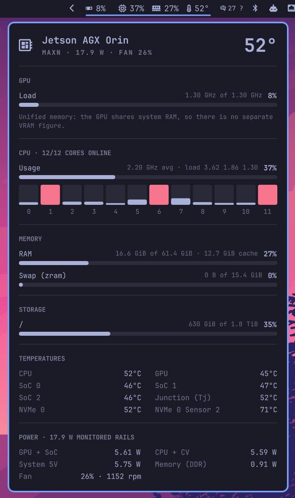

# Jetson SysMon for Omarchy

A bar widget for [Omarchy](https://omarchy.org) on **NVIDIA Jetson** boards:
GPU load, CPU usage, RAM, disk and temperature at a glance, and a click-open
panel with per-core load, every thermal zone, power rails, fan and the current
power mode.




## Why another system monitor?

Omarchy's community monitors read the GPU through `nvidia-smi` or AMD's
`gpu_busy_percent`. Neither exists on a Jetson: the GPU is integrated into the
SoC, `nvidia-smi` reports `N/A`, and there is no separate VRAM. This plugin
reads the Jetson's own sysfs nodes instead, so the GPU figure is real, and it
needs no root, no `tegrastats` and no `nvidia-smi`.

## Install

```bash
omarchy plugin add https://github.com/Babbletrax/omarchy-jetson-sysmon.git --enable
```

The widget lands in the right-hand section of the bar. Move it with
`omarchy bar move babbletrax.jetson-sysmon --section right --index 1`, or in
Setup > Bar. Update with `omarchy plugin update babbletrax.jetson-sysmon`.

Requirements: Omarchy with the Quickshell shell (4.x), `python3` (standard
library only), and a Nerd Font for the icons (Omarchy ships JetBrainsMono
Nerd Font). Switch **Bar labels** to `text` if you use a font without icons.

## Using it

| Action | Result |
| --- | --- |
| Left click | Open or close the detail panel |
| Right click | Open `btop` |
| Middle click | Restart the helper (re-detect sensors and power mode) |
| `Esc` in the panel | Close it; `Tab` moves to the next bar panel |

Values turn the theme's yellow at the warning threshold and its red at the
critical one. Colours, fonts and spacing come from the active Omarchy theme
and follow theme changes.

From a script: `omarchy-shell shell toggle babbletrax.jetson-sysmon '{}'`.

## Supported boards

| Board | Status |
| --- | --- |
| Jetson AGX Orin (64 GB, 32 GB) | Tested on hardware: GPU, CPU, RAM, disk, all zones, INA3221 rails, fan, nvpmodel |
| Jetson Orin NX / Orin Nano | Same Orin sysfs layout (`17000000.gpu`, `tj-thermal`, INA3221 with `VDD_IN`); expected to work |
| Jetson Xavier NX / AGX Xavier | GPU via `gv11b` devfreq and `gpu.0/load`; covered by the test fixtures, not tested on hardware |
| Jetson Nano / TX1 / TX2 | Legacy `gm20b` / `gp10b` names are detected; not tested |
| Jetson Thor | Untested. If the GPU node isn't found the GPU segment is hidden and the panel says so |
| Any other Linux | Works as a plain CPU/RAM/disk/temperature monitor; GPU and power are hidden |

Reports from other boards are welcome: open an issue with the output of
`python3 jetson_sysmon.py --once` from the plugin folder.

## Data sources

Everything comes from `jetson_sysmon.py`, which stays running and prints one
JSON line per refresh interval (2 s by default). Paths are detected once at
start and again every five minutes.

| Metric | Source |
| --- | --- |
| GPU load | `<gpu device>/load` (tenths of a percent, 0 to 1000), found through `/sys/class/devfreq/*gpu*` or `gv11b`/`ga10b`/`gp10b`/`gm20b`, falling back to `/sys/devices/platform/bus@0/*.gpu/load`, `/sys/devices/gpu.0/load` and similar |
| GPU clock | devfreq `cur_freq`, `max_freq`, `min_freq` |
| GPU memory | Not shown as a number. Jetson memory is unified: the GPU allocates from system RAM, which the RAM figure already includes |
| CPU usage | `/proc/stat`, total and per core; offline cores (lower nvpmodel modes) from `/sys/devices/system/cpu/online` |
| CPU clock | `/sys/devices/system/cpu/cpu*/cpufreq/scaling_cur_freq`, `cpuinfo_max_freq` |
| RAM, swap | `/proc/meminfo` (used = `MemTotal` - `MemAvailable`); zram compression from `/sys/block/zram*/mm_stat` |
| Disk | `statvfs()` on each configured mount point, with `df` semantics |
| Temperatures | `/sys/class/thermal/thermal_zone*/type` and `temp`. Zones that read `ENODATA` (Orin's `cv0`-`cv2`) are skipped; a zone that has read before and then fails (Orin's `gpu-thermal` while the GPU is power-gated) shows a dash. NVMe `Composite` temperature from hwmon |
| Power | INA3221 hwmon channels: watts = `in*_input` (mV) x `curr*_input` (mA). The total is the `VDD_IN` input rail when the board has one (Orin NX/Nano, Xavier), otherwise the sum of the monitored rails (AGX Orin) |
| Fan | `pwmfan` `pwm1` (duty cycle) and `pwm_tach` `rpm` |
| Power mode | `/var/lib/nvpmodel/status` mapped to a name through `/etc/nvpmodel.conf` |
| Board | `/proc/device-tree/model` |

Overhead on an AGX Orin at the default 2 s interval: about 0.15% of one core
and 18 MB resident for the helper; the shell does no polling of its own.

## Settings

Edit them in Setup > Bar, or set them on the widget's entry in
`~/.config/omarchy/shell.json`, for example
`omarchy bar set babbletrax.jetson-sysmon intervalSec 5`.

| Key | Default | Meaning |
| --- | --- | --- |
| `metrics` | `["gpu","cpu","ram","temp"]` | What the bar shows: any of `gpu`, `cpu`, `ram`, `disk`, `temp`, `power` |
| `labelStyle` | `icons` | `icons` (Nerd Font) or `text` (GPU, CPU, RAM ...) |
| `intervalSec` | `2` | Refresh interval, 1 to 30 seconds |
| `mounts` | `/` | Comma-separated mount points for the panel; the bar's disk metric uses the first |
| `tempSensor` | `auto` | Bar temperature: `auto` (junction `tj` if present, else hottest), `max`, or a zone name such as `cpu`, `gpu`, `soc0`, `nvme0` |
| `tempUnit` | `C` | `C` or `F` |
| `tempWarn` / `tempCrit` | `70` / `85` | Temperature thresholds in degrees Celsius |
| `loadWarn` / `loadCrit` | `75` / `90` | Usage thresholds in percent (GPU, CPU, RAM, disk) |

## Troubleshooting

- **GPU shows a dash or is missing.** Check that the load node is readable:
  `cat /sys/devices/platform/bus@0/17000000.gpu/load` (Orin) or
  `ls /sys/class/devfreq/`. Some kernels make `load` root-only; the plugin
  never asks for root, so the GPU segment is hidden in that case.
- **GPU temperature shows a dash.** Normal on Orin when the GPU is idle and
  power-gated; it comes back as soon as the GPU wakes.
- **No power section.** The INA3221 hwmon driver isn't bound, or its files
  aren't readable without root.
- **No power mode.** `/var/lib/nvpmodel/status` doesn't exist until
  `nvpmodel` has set a mode at least once.
- **Icons are boxes.** Your bar font has no Nerd Font glyphs; set
  `labelStyle` to `text`.
- **Nothing at all.** Run the helper by hand from the plugin folder:
  `python3 ~/.config/omarchy/plugins/babbletrax.jetson-sysmon/jetson_sysmon.py --once`.
  Errors are also logged by the shell (`journalctl --user -b | grep jetson-sysmon`).
- **Code changes don't show up while developing.** Restart the shell
  (`omarchy restart shell`) after editing the QML; the shell may keep the
  previously compiled component cached.

## Development

```bash
scripts/check.sh            # everything CI runs; skips tools you don't have
scripts/check.sh --strict   # fail when a tool is missing (CI mode)
python3 jetson_sysmon.py --once | python3 -m json.tool
```

The helper takes `--root DIR` so every `/proc` and `/sys` read can point at a
fake tree. The tests build such trees from the JSON fixtures in
`tests/fixtures/` (AGX Orin, Xavier NX and a generic PC); fixtures are JSON
because sysfs is mostly symlinks and Omarchy refuses symlinks inside a plugin.
`Model.js` holds the formatting and threshold logic and is tested with plain
Node (`node tests/model.test.js`). CI (GitHub Actions and GitLab) runs
qmllint, ShellCheck, shfmt, gitleaks and a scan for private paths, addresses
and hostnames.

## Credits

Made on Omarchy on a Jetson AGX Orin, part of
[omarchy-jetson](https://github.com/Babbletrax/omarchy-jetson). The panel
follows the look of Omarchy's own panels and uses the shell's UI components;
see [NOTICE](NOTICE) for the projects studied along the way.

## License

[MIT](LICENSE)
